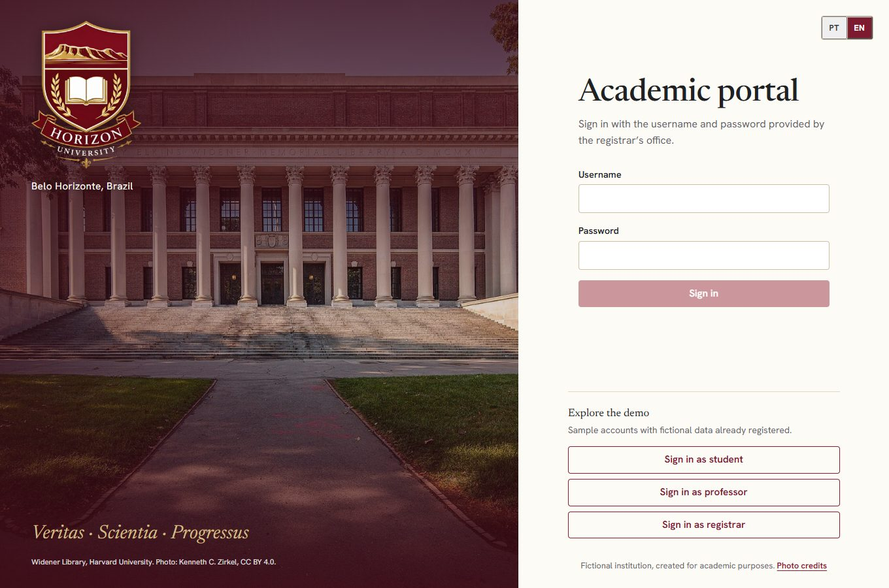
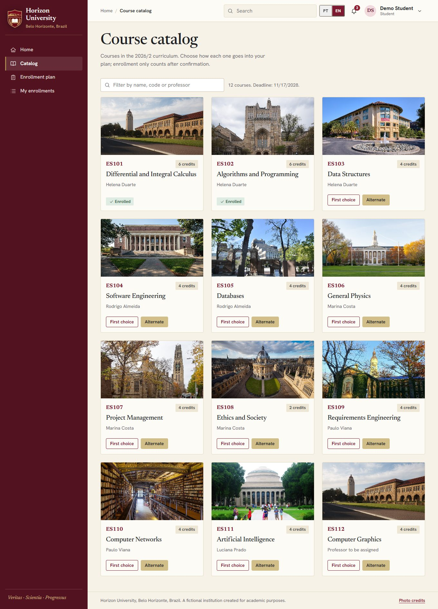
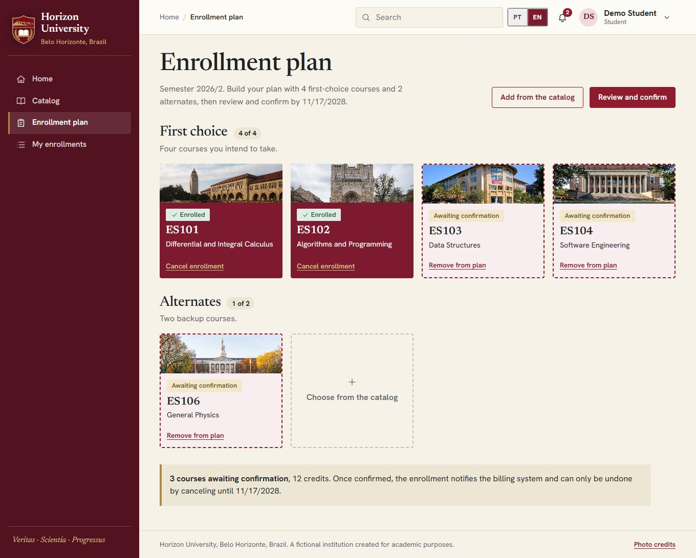
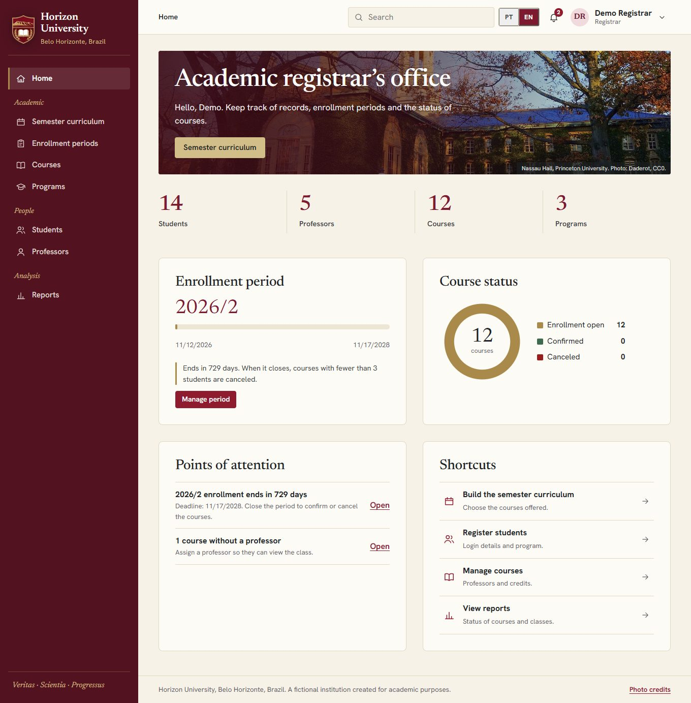
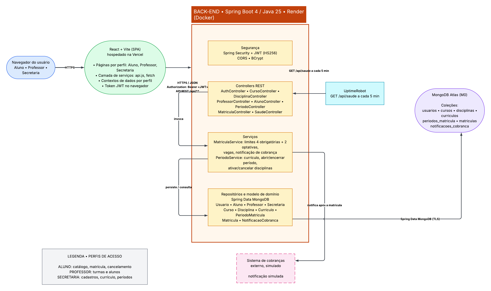

# 🎓 University Enrollment System

<p align="center">
  <picture>
    <source media="(prefers-color-scheme: dark)" srcset="frontend/public/brasao-claro.webp">
    
  </picture>
</p>

<p align="center"><a href="README.md">🇧🇷 Leia este README em português</a></p>

> [!NOTE]
> A web system that computerizes university enrollment: the registrar builds each semester's curriculum, students enroll (or cancel) during the enrollment period, and professors see who is enrolled in each of their courses. Built as an academic project (Lab 03, DIAW, Software Engineering, PUC Minas) and presented as a portfolio piece under a fictional institution, **Horizon University** (Belo Horizonte, Brazil).

This is a short English overview. The Portuguese [README](README.md) is the complete reference: user stories, business rules, class diagram, comparison between the initial model and the final prototype, and photo credits.

---

## 🌐 Live Demo

**https://sistema-matriculas-inky.vercel.app**

Use the **PT | EN** switch (on the login screen and in the header) to change the language. It also translates the demo data, such as program and course names. The **Sign in as student / professor / registrar** buttons open the portal with fictional data already registered. All demo accounts use the password `demo12345`:

| Role | Username |
| :--- | :--- |
| Student | `demo.aluno` |
| Professor | `demo.professor` |
| Registrar | `demo.secretaria` |

> [!NOTE]
> The back end runs on Render's free plan and the database on MongoDB Atlas. If the service is asleep, the first request can take about a minute (an uptime monitor pings `GET /api/saude` every 5 minutes to keep it awake).

> [!WARNING]
> The data is fictional and shared by all visitors. Actions such as closing the enrollment period change the demo for everyone.

---

## 📸 Screenshots (English interface)

| Sign in | Course catalog (student) |
| :---: | :---: |
|  |  |

| Enrollment plan: 4 first-choice courses + 2 alternates | Registrar dashboard |
| :---: | :---: |
|  |  |

---

## ✨ Features

- 🔐 **Authentication:** mandatory username and password for students, professors and the registrar (JWT, passwords hashed with BCrypt).
- 🗂️ **Academic management (registrar):** programs, courses, professors, students and the curriculum of each semester.
- 📅 **Enrollment periods:** opened by the registrar and closed either by the registrar or automatically after the end date.
- 📝 **Enrollment and cancellation (student):** 4 first-choice courses + 2 alternates, with a review-and-confirm step.
- ✅ **Course activation:** at the end of the period, courses with fewer than 3 students are canceled; each course accepts at most 60 students.
- 💳 **Billing integration:** the billing system is notified after enrollment (simulated).
- 👨‍🏫 **Class rosters (professor):** who is enrolled in each of their courses, with search and CSV export.
- 🌐 **Bilingual interface:** Portuguese and English.

## 🛠 Stack

| Layer | Technology |
| :--- | :--- |
| Language | Java 25 |
| Back end | Spring Boot 4.0.x, Spring Security (JWT), Spring Data MongoDB |
| Build | Apache Maven |
| Front end | React + Vite (no UI or i18n libraries) |
| Database | MongoDB Atlas |
| Hosting | Vercel (front end), Render (back end, Docker), MongoDB Atlas |

## 🏗 Architecture



Layered REST API (security → controllers → services → repositories). Class diagrams: [initial version](docs/diagramas/classes-v1.png) and [final version](docs/diagramas/classes.png).

## 🔧 Running locally

Requirements: Java 25, Node.js 22+ and a MongoDB (Atlas or `docker run -d --name mongo-dev -p 27017:27017 mongo:7`).

```bash
# Terminal 1: back end (http://localhost:8080)
cd backend
./mvnw spring-boot:run

# Terminal 2: front end (http://localhost:5173)
cd frontend
npm install
npm run dev
```

Useful environment variables for the back end: `MONGODB_URI`, `JWT_SECRET`, `CORS_ORIGENS`, `DEMO_ENABLED=true` (creates the fictional demo data on an empty database) and `PERIODO_ENCERRAMENTO_AUTOMATICO`. For the front end: `VITE_API_URL` and `VITE_MODO_DEMO=true` (quick sign-in buttons). See the Portuguese README for details and the API summary.

## 🌐 How the translation works

There is no i18n library. The Portuguese text is the dictionary key (`frontend/src/i18n/`), so any missing entry simply falls back to Portuguese. The English dictionary also covers the demo data (program and course names), dates (`MM/DD/YYYY` in English) and the back end's error messages, which are translated on the front end without changing the API.

## 🙏 Credits

- Prof. João Paulo Carneiro Aramuni (PUC Minas), for the assignment and guidance.
- University photographs are real, freely licensed pictures from Wikimedia Commons, used as visual reference only; Horizon University is fictional. Authors and licenses are listed in the Portuguese README.

## 📄 License

Academic project. MIT License.
