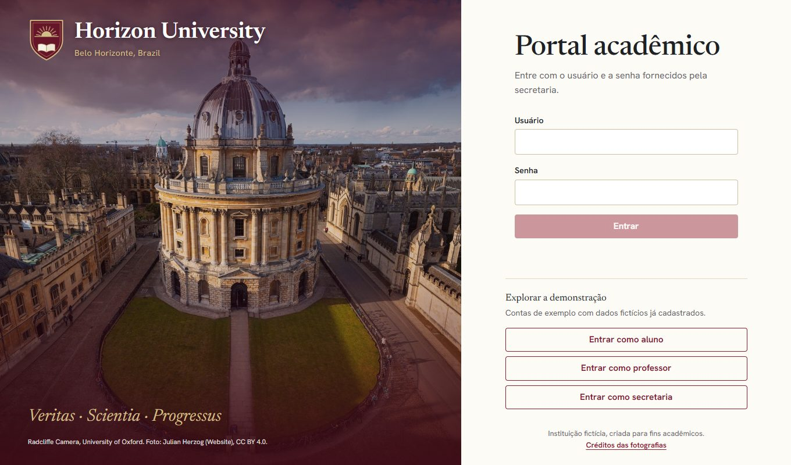
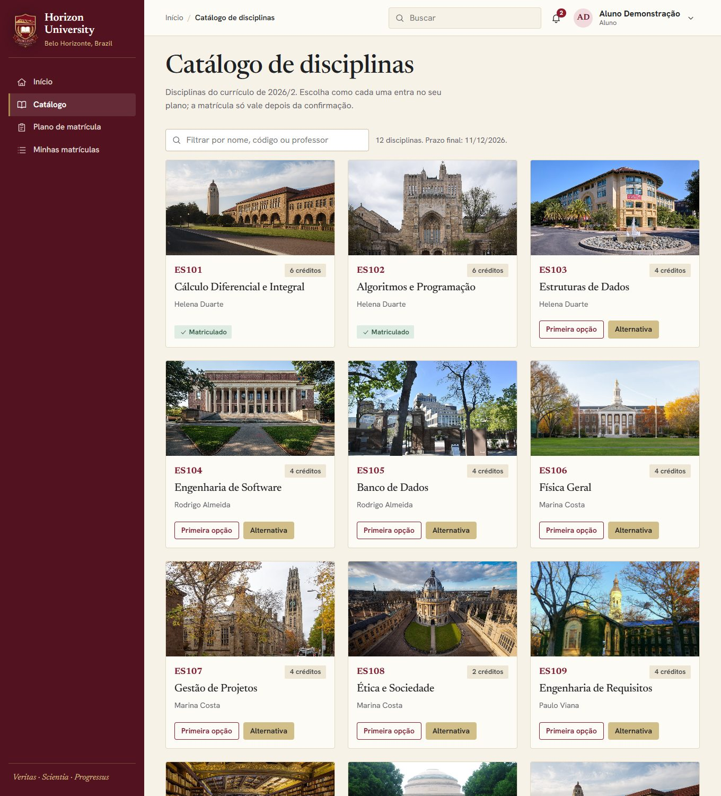
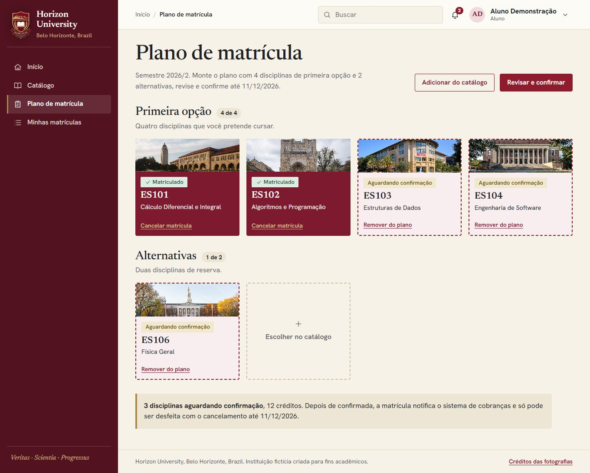
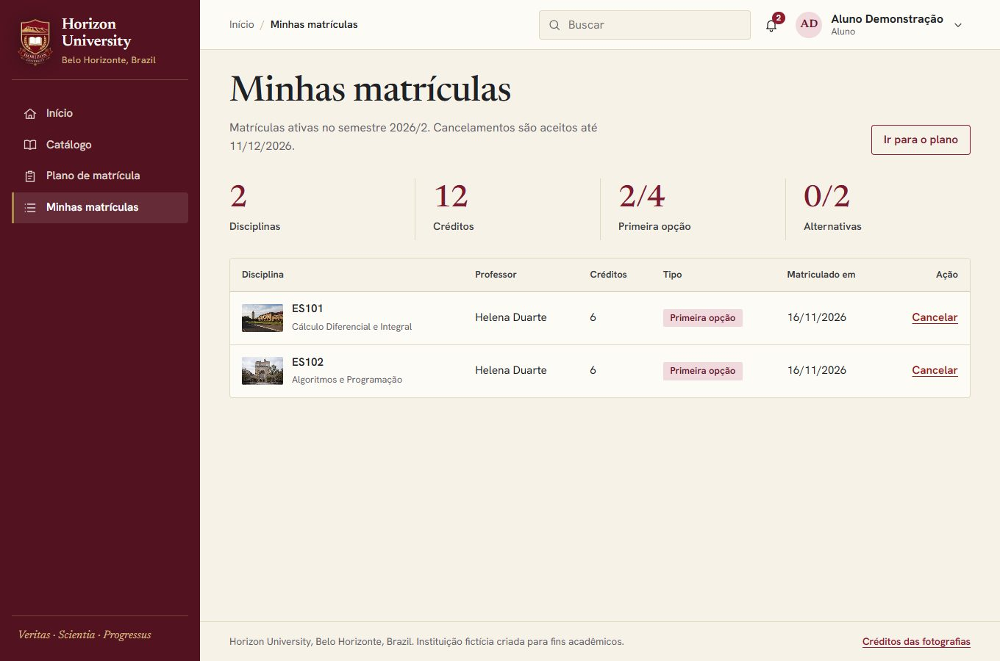
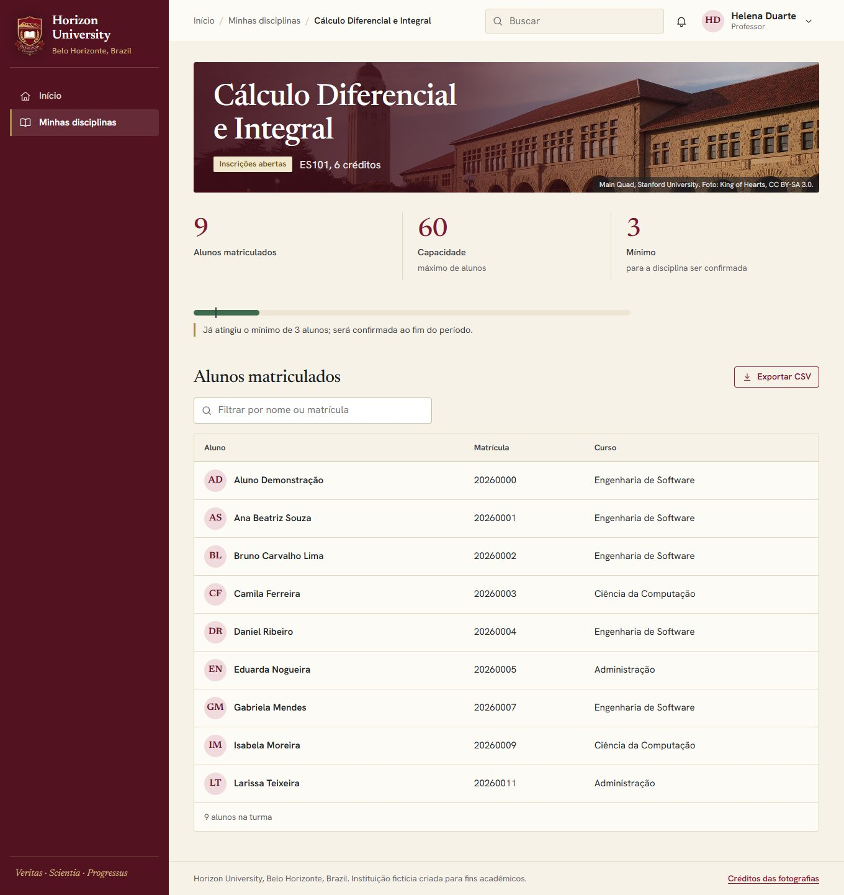
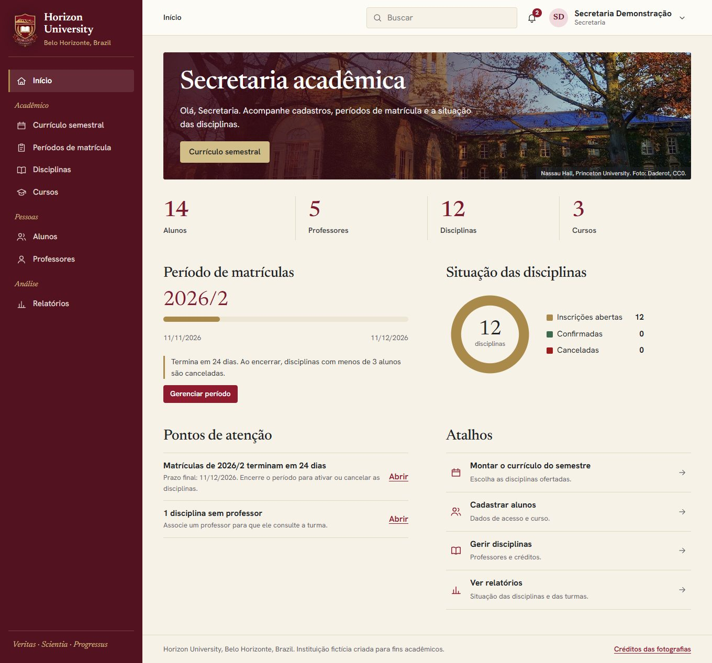
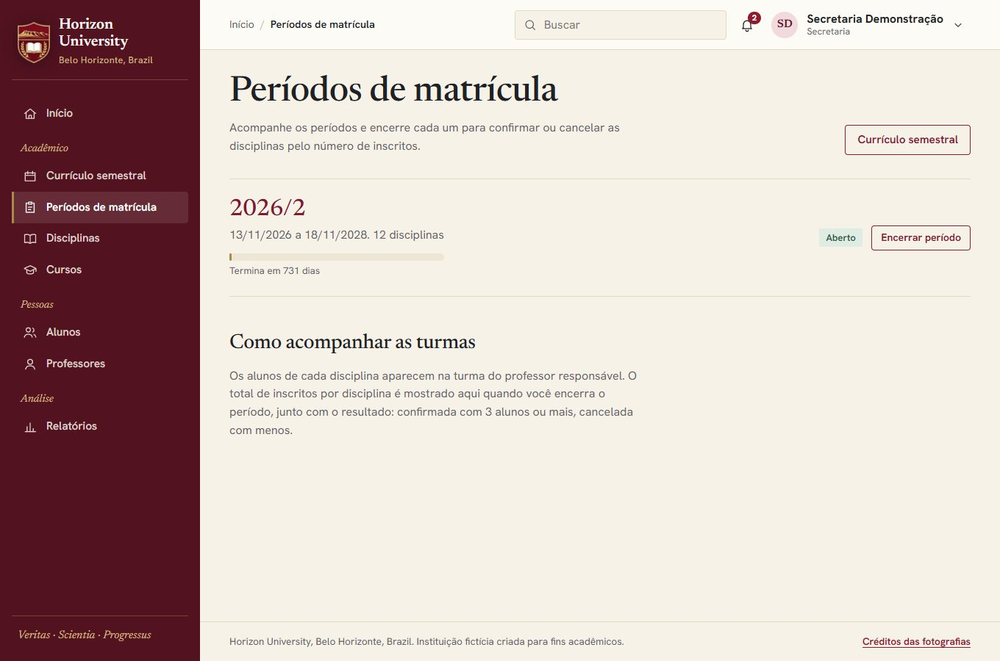
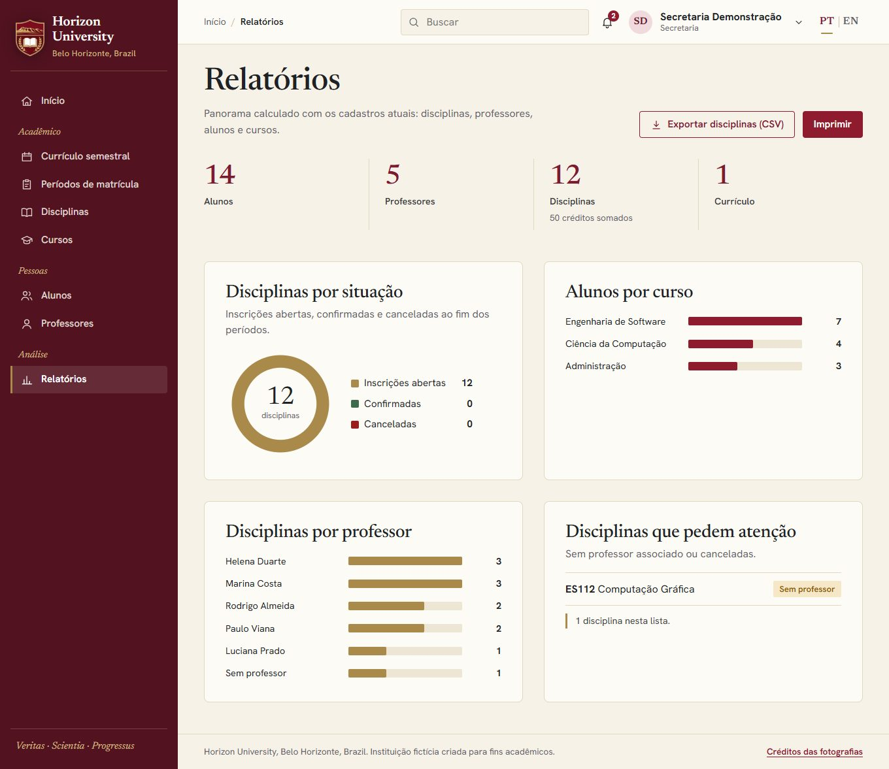
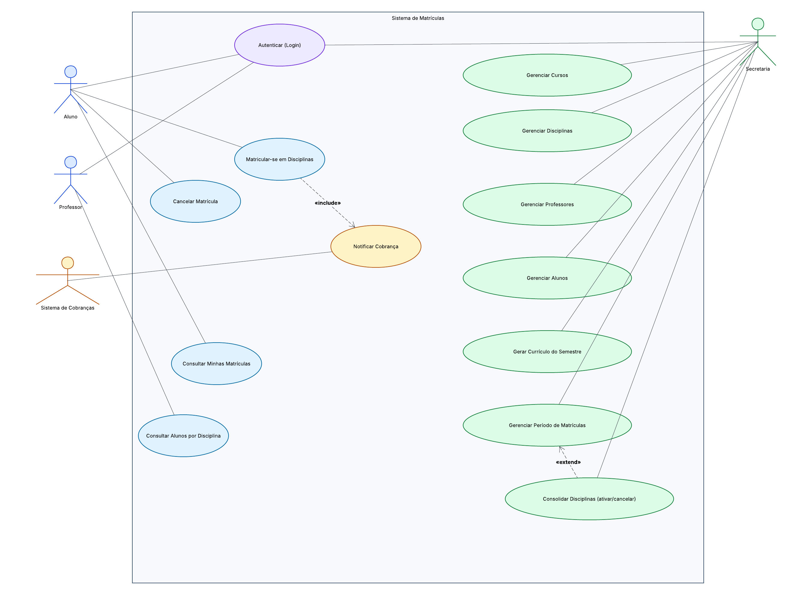

# 🎓 Sistema de Matrículas Universitário 👨‍💻

> [!NOTE]
> Sistema web para informatizar o processo de matrículas de uma universidade: a secretaria monta o currículo do semestre, os alunos se matriculam (ou cancelam) dentro do período de matrículas e os professores consultam seus alunos.

<p align="center">
  <picture>
    <source media="(prefers-color-scheme: dark)" srcset="frontend/public/brasao-claro.webp">
    
  </picture>
</p>

---

## 🚧 Status do Projeto


| Etapa | Status |
| :--- | :---: |
| Modelo de Análise (Casos de Uso + Histórias de Usuário) | ✅ |
| Projeto Estrutural: projeto Spring Boot com classes, atributos e stubs | ✅ |
| Projeto Estrutural: Diagrama de Classes (Lucidchart) | ✅ |
| Autenticação (login com senha, JWT) | ✅ |
| Protótipo: back-end (regras de negócio + API REST) | ✅ |
| Protótipo: front-end (React + Vite) | ✅ |
| Redesign do front-end (identidade Horizon University) | ✅ |
| Persistência no MongoDB Atlas | ✅ |
| Publicação online (Vercel + Render + Atlas) | ✅ |
| Correção dos diagramas | ✅ |

---

## 🌐 Demonstração Online

**Acesse: https://sistema-matriculas-inky.vercel.app**

Na tela de login, os botões **Entrar como aluno / professor / secretaria** abrem o portal com dados fictícios já cadastrados (3 cursos, 5 professores, 12 disciplinas, 14 alunos e um período de matrículas aberto). Todas as contas de demonstração usam a senha `demo12345`:

| Perfil | Usuário |
| :--- | :--- |
| Aluno | `demo.aluno` |
| Professor | `demo.professor` |
| Secretaria | `demo.secretaria` |

> [!NOTE]
> O back-end roda no plano gratuito da Render e o banco no MongoDB Atlas. Se o serviço estiver hibernado, a primeira requisição pode levar cerca de um minuto. Um monitor (UptimeRobot) consulta `GET /api/saude` a cada 5 minutos para mantê-lo acordado.

> [!WARNING]
> Os dados são fictícios e compartilhados por todos os visitantes. Ações como encerrar o período de matrículas alteram a demonstração para todos.

---

## 📚 Índice
- [Demonstração Online](#-demonstração-online)
- [Links Úteis](#-links-úteis)
- [Sobre o Projeto](#-sobre-o-projeto)
- [Funcionalidades Principais](#-funcionalidades-principais)
- [Telas do Sistema](#-telas-do-sistema)
- [Tecnologias Utilizadas](#-tecnologias-utilizadas)
- [Modelo de Análise](#-modelo-de-análise)
  - [Atores](#atores)
  - [Diagrama de Casos de Uso](#diagrama-de-casos-de-uso)
  - [Regras de Negócio](#regras-de-negócio)
  - [Histórias de Usuário](#histórias-de-usuário)
- [Arquitetura e Diagramas](#-arquitetura-e-diagrama-de-classes)
- [Do Modelo Inicial ao Protótipo Final](#-do-modelo-inicial-ao-protótipo-final)
- [Instalação e Execução](#-instalação-e-execução)
- [Estrutura de Pastas](#-estrutura-de-pastas)
- [Identidade Visual e créditos das fotografias](#-identidade-visual-horizon-university)
- [Documentações utilizadas](#-documentações-utilizadas)
- [Autores](#-autores)
- [Contribuição](#-contribuição)
- [Agradecimentos](#-agradecimentos)
- [Licença](#-licença)

---

## 🔗 Links Úteis

| Recurso | Link |
| :--- | :--- |
| 🌐 Demonstração online | https://sistema-matriculas-inky.vercel.app |
| 📦 Repositório | https://github.com/diegovitorportella/sistema-matriculas |
| 🗺️ Diagramas UML | [docs/diagramas](docs/diagramas) |
| 📋 Histórias de usuário | [Histórias de Usuário](#histórias-de-usuário) |

---

## 📝 Sobre o Projeto

Uma universidade pretende informatizar seu sistema de matrículas. Hoje a secretaria precisa gerir manualmente currículos, disciplinas, professores e alunos, além de acompanhar quais disciplinas atingiram o mínimo de inscritos.

O sistema resolve isso permitindo que:

- a **secretaria** gere o currículo de cada semestre e mantenha o cadastro de cursos, disciplinas, professores e alunos;
- o **aluno** se matricule em disciplinas (4 obrigatórias + 2 optativas) e cancele matrículas durante o período de matrículas;
- o **professor** consulte os alunos matriculados em cada uma de suas disciplinas;
- o **sistema de cobranças** seja notificado após a matrícula do aluno, para cobrar as disciplinas do semestre.

Contexto: projeto acadêmico (Laboratório 03 — DIAW, Engenharia de Software, PUC Minas).

---

## ✨ Funcionalidades Principais

- 🔐 **Autenticação:** login obrigatório (usuário e senha) para alunos, professores e secretaria.
- 🗂️ **Gestão acadêmica (secretaria):** cursos, disciplinas, professores, alunos e currículo por semestre.
- 📅 **Períodos de matrícula:** abertura e encerramento controlados pela secretaria.
- 📝 **Matrícula e cancelamento (aluno):** 4 disciplinas obrigatórias + 2 optativas.
- ✅ **Ativação de disciplinas:** ao fim do período, disciplinas com menos de 3 inscritos são canceladas; limite de 60 inscritos por disciplina.
- 💳 **Integração com cobranças:** notificação ao sistema de cobranças após a matrícula.
- 👨‍🏫 **Consulta de alunos por disciplina (professor).**

---

## 📸 Telas do Sistema

Capturas da demonstração online. O portal usa a identidade fictícia **Horizon University**.

| Login com acesso rápido à demonstração | Catálogo de disciplinas (aluno) |
| :---: | :---: |
|  |  |

| Plano de matrícula: 4 de primeira opção + 2 alternativas | Minhas matrículas (aluno) |
| :---: | :---: |
|  |  |

| Alunos matriculados na disciplina (professor) | Painel da secretaria |
| :---: | :---: |
|  |  |

| Período de matrículas (secretaria) | Relatórios (secretaria) |
| :---: | :---: |
|  |  |

---

## 🛠 Tecnologias Utilizadas

| Camada | Tecnologia |
| :--- | :--- |
| Linguagem | Java – JDK 25 |
| Back-end | Spring Boot 4.0.x |
| Build/dependências | Apache Maven |
| Front-end | React + Vite |
| Banco de dados | MongoDB Atlas (Spring Data MongoDB) |
| Autenticação | Login e senha (Spring Security, senhas com hash) |

---

## 🧭 Modelo de Análise

### Atores

| Ator | Descrição |
| :--- | :--- |
| **Aluno** | Realiza e cancela matrículas dentro do período aberto. |
| **Professor** | Consulta os alunos matriculados em suas disciplinas. |
| **Secretaria** | Gerencia cadastros, currículo e períodos de matrícula. |
| **Sistema de Cobranças** | Sistema externo notificado após a matrícula do aluno. |

### Diagrama de Casos de Uso

<!-- TODO: exportar o diagrama do Lucidchart como PNG, salvar em docs/diagramas/casos-de-uso.png -->


### Regras de Negócio

| ID | Regra |
| :---: | :--- |
| RN01 | Todo usuário (aluno, professor, secretaria) deve se autenticar com usuário e senha. |
| RN02 | Cada curso possui nome, número de créditos e é composto por diversas disciplinas. |
| RN03 | O aluno pode se matricular em **4 disciplinas obrigatórias** e **2 optativas** (alternativas). |
| RN04 | Matrículas e cancelamentos só são possíveis **durante o período de matrículas**. |
| RN05 | Ao fim do período, a disciplina com **menos de 3 alunos** matriculados é **cancelada**; com 3 ou mais, fica **ativa** no semestre seguinte. |
| RN06 | O máximo é de **60 alunos** por disciplina; ao atingi-lo, as matrículas dessa disciplina são encerradas. |
| RN07 | Após o aluno se inscrever no semestre, o **sistema de cobranças é notificado**. |
| RN08 | O professor só visualiza os alunos das disciplinas em que leciona. |

> [!NOTE]
> O encerramento do período (RN05) acontece de duas formas: automaticamente, depois da data final (uma tarefa agendada verifica a cada hora), ou antes, quando a secretaria clica em **Encerrar período**. Nos dois casos, cada disciplina do currículo é confirmada (3 alunos ou mais) ou cancelada.

### Histórias de Usuário

#### 🔐 Autenticação

**US01 — Login**
> Como **usuário** (aluno, professor ou secretaria), quero **entrar no sistema com usuário e senha**, para **acessar as funcionalidades do meu perfil**.
- [ ] Credenciais válidas levam ao painel do perfil correspondente.
- [ ] Credenciais inválidas exibem mensagem de erro e não dão acesso.
- [ ] Rotas protegidas exigem autenticação e respeitam o perfil.

**US02 — Logout**
> Como **usuário**, quero **sair do sistema**, para **proteger minha conta**.
- [ ] Após o logout, a sessão/token é invalidado.

#### 🏛️ Secretaria

**US03 — Gerenciar cursos**
> Como **secretaria**, quero **cadastrar, editar e remover cursos** (nome e número de créditos), para **manter a estrutura acadêmica atualizada**.
- [ ] Curso exige nome e número de créditos.
- [ ] Curso pode ser associado a várias disciplinas.

**US04 — Gerenciar disciplinas**
> Como **secretaria**, quero **cadastrar, editar e remover disciplinas**, para **compor os cursos e o currículo**.
- [ ] Disciplina informa nome, código, créditos e professor responsável.
- [ ] Limites de 3 (mínimo) e 60 (máximo) inscritos são aplicados.

**US05 — Gerenciar professores**
> Como **secretaria**, quero **cadastrar, editar e remover professores**, para **alocá-los às disciplinas**.
- [ ] Ao cadastrar, é definida uma senha de acesso.

**US06 — Gerenciar alunos**
> Como **secretaria**, quero **cadastrar, editar e remover alunos**, para **que possam acessar o sistema e se matricular**.
- [ ] Ao cadastrar, é definida uma senha de acesso e o curso do aluno.

**US07 — Gerar currículo do semestre**
> Como **secretaria**, quero **gerar o currículo de cada semestre**, associando as disciplinas ofertadas, para **que os alunos saibam o que podem cursar**.
- [ ] O currículo é vinculado a um semestre (ex.: 2026/2).
- [ ] Apenas disciplinas do currículo ficam disponíveis para matrícula.

**US08 — Gerenciar período de matrículas**
> Como **secretaria**, quero **abrir e encerrar o período de matrículas**, para **controlar quando os alunos podem se matricular ou cancelar**.
- [ ] Define data de início e fim.
- [ ] Fora do período, matrículas e cancelamentos são bloqueados.

**US09 — Consolidar disciplinas ao fim do período**
> Como **secretaria**, quero que, **ao encerrar o período, o sistema ative ou cancele cada disciplina**, para **confirmar quais ocorrerão no semestre seguinte**.
- [ ] Disciplina com ≥ 3 inscritos fica **ativa**.
- [ ] Disciplina com < 3 inscritos fica **cancelada**.
- [ ] A secretaria consegue consultar o resultado por disciplina.

#### 🎒 Aluno

**US10 — Matricular-se em disciplinas**
> Como **aluno**, quero **me matricular em disciplinas do semestre**, para **cursá-las**.
- [ ] O aluno escolhe o tipo de cada matrícula: até 4 como obrigatórias (1ª opção) e 2 como optativas (alternativas).
- [ ] Bloqueia matrícula em disciplina com 60 inscritos.
- [ ] Só funciona dentro do período de matrículas.
- [ ] Não permite matrícula duplicada na mesma disciplina.

**US11 — Cancelar matrícula**
> Como **aluno**, quero **cancelar uma matrícula feita anteriormente**, para **ajustar minhas escolhas**.
- [ ] Só funciona dentro do período de matrículas.
- [ ] A vaga é liberada na disciplina.

**US12 — Consultar minhas matrículas**
> Como **aluno**, quero **ver as disciplinas em que estou matriculado e o status de cada uma**, para **acompanhar minha situação**.
- [ ] Lista disciplinas, tipo (obrigatória/optativa) e status (ativa/cancelada após o fim do período).

**US13 — Notificar cobrança**
> Como **aluno**, quero que **o sistema de cobranças seja notificado após eu concluir a matrícula do semestre**, para **ser cobrado pelas disciplinas cursadas**.
- [ ] A notificação contém aluno, semestre e disciplinas.
- [ ] Falhas na notificação são registradas para novo envio.

#### 👨‍🏫 Professor

**US14 — Consultar alunos por disciplina**
> Como **professor**, quero **ver a lista de alunos matriculados em cada uma das minhas disciplinas**, para **acompanhar a turma**.
- [ ] Lista apenas disciplinas do professor autenticado.
- [ ] Mostra nome e matrícula dos alunos.

---

## 🏗 Arquitetura e Diagrama de Classes

### Diagrama de Classes


As classes do pacote `model` do back-end seguem este diagrama (atributos e assinaturas dos métodos); as associações são persistidas com `@DBRef` no MongoDB. Os métodos de `Aluno`, `Professor` e `Secretaria` são stubs de modelagem: a lógica está em `MatriculaService` e `PeriodoService`.

### Diagrama de Arquitetura


**API REST em camadas** (segurança → controllers → serviços → repositórios) com Spring Boot, front-end SPA em React + Vite e persistência em MongoDB Atlas. A autenticação usa JWT (HS256) e as senhas são armazenadas com BCrypt. O sistema de cobranças é externo e tem a notificação simulada.

### Versões dos diagramas

| Arquivo | Versão | Descrição |
| :--- | :---: | :--- |
| [casos-de-uso.png](docs/diagramas/casos-de-uso.png) | v1 | Diagrama de casos de uso (modelo de análise) |
| [classes-v1.png](docs/diagramas/classes-v1.png) | v1 | Diagrama de classes inicial, antes da implementação |
| [classes.png](docs/diagramas/classes.png) | v2 | Diagrama de classes atualizado com o código final (`encerrado`, `matriculadosAtivos`, `perfil()`, tipos `LocalDate` e `LocalDateTime`) |
| [arquitetura.png](docs/diagramas/arquitetura.png) | v1 | Arquitetura em camadas e implantação (Vercel, Render, MongoDB Atlas) |

As diferenças entre o modelo inicial e o protótipo estão na próxima seção.

---

## 🔄 Do Modelo Inicial ao Protótipo Final

O diagrama de classes foi o ponto de partida do código. Durante a implementação, algumas decisões exigiram ajustes em relação ao modelo inicial:

| Elemento | Modelo inicial | Protótipo final | Motivo |
| :--- | :--- | :--- | :--- |
| `PeriodoMatricula` | `inicio`, `fim`, `semestre` e `estaAberto()` | Inclui o atributo **`encerrado`**; `estaAberto()` só é verdadeiro se o período não foi encerrado e hoje está entre `inicio` e `fim` | A secretaria precisa encerrar o período manualmente, e a consolidação (ativar ou cancelar disciplinas) acontece nesse momento |
| `Disciplina` | `totalMatriculados()`, `temVaga()`, `avaliarAtivacao()` | Inclui **`matriculadosAtivos`** (campo `@Transient`) preenchido pelo serviço | A contagem vem das matrículas ativas do período corrente, que ficam em outra coleção; o objeto de domínio só aplica a regra (mínimo de 3, máximo de 60) |
| `Usuario` | `autenticar(senha)` | Inclui **`perfil()`**, derivado do tipo concreto | O token JWT precisa informar o papel (ALUNO, PROFESSOR ou SECRETARIA) para o controle de acesso |
| Métodos de `Aluno`, `Professor` e `Secretaria` | `matricular`, `cancelarMatricula`, `consultarMatriculas`, `consultarAlunos`, `gerarCurriculo`, `abrirPeriodoMatriculas`, `encerrarPeriodoMatriculas` | Permanecem como **stubs** (`UnsupportedOperationException`); a lógica real está em `MatriculaService` e `PeriodoService` | Essas operações dependem de repositórios e de várias entidades; ficaram na camada de serviço (controller → service → repository), mantendo o modelo de domínio sem dependência de persistência |
| Persistência de usuários | Três classes distintas | `Aluno`, `Professor` e `Secretaria` compartilham a coleção `usuarios` do MongoDB, diferenciadas pelo campo `_class` | Uma coleção única simplifica o login (busca por `login` entre todos os perfis); as listagens de alunos e professores filtram pelo tipo |
| Sistema de cobranças | Notificação ao sistema externo | `NotificacaoCobranca` registrada e envio **simulado** (`enviar()`) | O sistema de cobranças é externo e não faz parte do protótipo |
| Camada de apresentação | Não modelada | DTOs (`Dtos.java`), controllers REST por perfil e SPA em React | Detalhes de implementação que não alteram o domínio |

Também foram adicionados, fora do modelo: o endpoint público `GET /api/saude` (monitoramento), o modo demonstração (`DEMO_ENABLED`) e o front-end com identidade visual própria.

---

## 🔧 Instalação e Execução

### Pré-requisitos

- Java JDK 25 e Maven (o projeto traz o wrapper `mvnw`)
- Node.js 22 ou superior
- Um MongoDB: cluster no **MongoDB Atlas** ou, para desenvolvimento, `docker run -d --name mongo-dev -p 27017:27017 mongo:7`

### Variáveis de ambiente (back-end)

| Variável | Descrição | Padrão (somente desenvolvimento) |
| :--- | :--- | :--- |
| `MONGODB_URI` | URI de conexão do MongoDB (Atlas: `mongodb+srv://...`) | `mongodb://localhost:27017/matriculas` |
| `JWT_SECRET` | Chave de assinatura dos tokens, mínimo de 32 caracteres | valor fixo de desenvolvimento |
| `SEED_LOGIN` / `SEED_SENHA` | Secretaria criada no primeiro acesso, se não existir | `secretaria` / `secretaria123` |
| `SERVER_PORT` | Porta da API | `8080` |
| `CORS_ORIGENS` | Origens permitidas (front-end) | `http://localhost:5173` |
| `PERIODO_ENCERRAMENTO_AUTOMATICO` | Encerra sozinho os períodos cuja data final já passou | `true` |
| `DEMO_ENABLED` | Cria dados fictícios de demonstração se o banco ainda não os tiver | `false` |
| `DEMO_SENHA` | Senha das contas de demonstração | `demo12345` |

Nunca versione credenciais. Use [backend/.env.example](backend/.env.example) como referência.

### Como executar

Em dois terminais:

```bash
# Terminal 1: back-end (http://localhost:8080)
cd backend
./mvnw spring-boot:run

# Terminal 2: front-end (http://localhost:5173)
cd frontend
npm install
npm run dev
```

Em desenvolvimento, o Vite repassa `/api` para o back-end (`BACKEND_URL`, padrão `http://localhost:8080`). Para outro endereço em produção, defina `VITE_API_URL` antes do `npm run build`.

### Primeiro acesso

1. Entre como secretaria com o usuário e a senha de `SEED_LOGIN` e `SEED_SENHA`.
2. Cadastre curso, professores, alunos e disciplinas.
3. Em **Semestre**, gere o currículo e abra o período de matrículas.
4. Entre como aluno para se matricular e como professor para ver as turmas.
5. Ao fim do período, a secretaria o encerra e o sistema ativa ou cancela cada disciplina.

### Modo demonstração (portfólio)

Para explorar o portal sem cadastrar nada, inicie o back-end com `DEMO_ENABLED=true`. Se o banco ainda não tiver as contas demo, o sistema cria 3 cursos, 5 professores, 12 disciplinas, 14 alunos, um currículo, um período de matrículas aberto (datas relativas a hoje) e matrículas feitas pelas mesmas regras de negócio da aplicação (limites 4 + 2, cobrança simulada). Algumas disciplinas ficam com 3 ou mais alunos e outras com menos, então o encerramento do período mostra os dois resultados.

No front-end, `VITE_MODO_DEMO=true` exibe na tela de login os botões de acesso rápido.

| Perfil | Usuário | Senha |
| :--- | :--- | :--- |
| Aluno | `demo.aluno` | `demo12345` |
| Professor | `demo.professor` | `demo12345` |
| Secretaria | `demo.secretaria` | `demo12345` |

Todos os dados são fictícios. Não use o modo demonstração em um sistema real.

### API REST (resumo)

| Perfil | Endpoints |
| :--- | :--- |
| Todos | `POST /api/auth/login`, `GET /api/auth/me` |
| Público | `GET /api/saude` (verificação de disponibilidade, sem dados) |
| Secretaria | CRUD em `/api/cursos`, `/api/disciplinas`, `/api/professores`, `/api/alunos`; `POST /api/curriculos`; `POST /api/periodos`; `POST /api/periodos/{id}/encerrar` |
| Aluno | `GET /api/disciplinas/ofertadas`, `POST /api/matriculas`, `DELETE /api/matriculas/{id}`, `GET /api/matriculas/minhas` |
| Professor | `GET /api/professores/me/disciplinas`, `GET /api/professores/me/disciplinas/{id}/alunos` |

### Publicação (demonstração online)

| Camada | Serviço | Configuração |
| :--- | :--- | :--- |
| Banco | MongoDB Atlas (M0 gratuito) | usuário de banco e acesso de rede liberado |
| Back-end | Render (Docker, região Ohio) | [render.yaml](render.yaml) e [backend/Dockerfile](backend/Dockerfile) |
| Front-end | Vercel | pasta raiz `frontend`, com [vercel.json](frontend/vercel.json) |

**Back-end (Render):** crie um Blueprint a partir do repositório. Preencha `MONGODB_URI` e `CORS_ORIGENS` (URL da Vercel). `JWT_SECRET` é gerado pela Render e `DEMO_ENABLED` já vem como `true`.

**Front-end (Vercel):** defina `VITE_API_URL` com a URL pública da API terminada em `/api` (por exemplo `https://matriculas-api.onrender.com/api`) e `VITE_MODO_DEMO=true`.

Observações:

- No plano gratuito a Render hiberna o serviço após alguns minutos sem uso. A primeira requisição pode levar cerca de um minuto.
- Na primeira inicialização o seeder cria os dados de demonstração, o que leva alguns minutos por causa da latência até o Atlas. Nas inicializações seguintes ele detecta que os dados já existem e não faz nada.
- Para restaurar a demonstração depois de mudanças dos visitantes, apague o banco `matriculas` no Atlas e reinicie o serviço.

### Testes

```bash
cd backend
./mvnw test -Dtest='UsuarioTest,RegrasDominioTest'
```

`MatriculasApplicationTests` sobe o contexto completo e exige um MongoDB acessível.

---

## 📂 Estrutura de Pastas

```
.
├── README.md
├── /docs
│   └── /diagramas      # Diagramas UML (casos de uso, classes) — todas as versões
├── /backend            # Spring Boot: model, repository, service, controller, security
└── /frontend           # React + Vite
    ├── /public/fotos   # Fotografias (Wikimedia Commons) com licença livre
    └── /src            # components, contexts, pages, services, styles, data
```

---

## 🎨 Identidade Visual: Horizon University

O front-end usa a identidade de uma universidade fictícia, a **Horizon University** (Belo Horizonte, Brazil; lema *Veritas · Scientia · Progressus*), inspirada nas universidades tradicionais americanas: bordô institucional, creme, ouro envelhecido e grafite, com títulos em serifa (Newsreader) e interface em sans-serif (Hanken Grotesk). O brasão é a marca visual fictícia fornecida pelo autor do projeto. A versão completa, com a faixa "HORIZON UNIVERSITY", aparece na tela de login (`brasao.webp`, e `brasao-claro.webp` sobre fundos escuros, com o texto "UNIVERSITY" em creme). Em tamanhos pequenos (barra lateral, tela de carregamento e favicon) usa-se somente o escudo (`brasao-escudo.webp`), porque o texto não seria legível. O componente é `frontend/src/components/Brasao.jsx`.

- **Aluno:** início, catálogo de disciplinas, plano de matrícula (4 de primeira opção e 2 alternativas, com revisão e confirmação), minhas matrículas e perfil.
- **Professor:** início, minhas disciplinas, detalhe da turma com lista de alunos (busca e exportação CSV) e perfil.
- **Secretaria:** início, currículo semestral, períodos de matrícula, disciplinas, cursos, alunos, professores e relatórios.
- Todas as telas usam os endpoints reais do back-end (camada de serviços em `frontend/src/services`). Avisos do sino, busca do cabeçalho e relatórios são calculados no cliente com dados reais da API.

### Créditos das fotografias

As fotografias são reais, de campi e bibliotecas de universidades internacionais, usadas como **referência visual** e armazenadas em `frontend/public/fotos`. Elas **não representam instalações da Horizon University**, que é fictícia. Todas têm licença livre (CC0, CC BY ou CC BY-SA) e o aplicativo mostra a legenda de cada imagem e a lista completa em "Créditos das fotografias".

| Local | Autor | Licença | Fonte |
| :--- | :--- | :--- | :--- |
| Radcliffe Camera, University of Oxford | Julian Herzog (Website) | [CC BY 4.0](https://creativecommons.org/licenses/by/4.0) | [Wikimedia Commons](https://commons.wikimedia.org/wiki/File:Radcliffe_Camera_Oxford_2018_02.jpg) |
| Main Quad, Stanford University | King of Hearts | [CC BY-SA 3.0](https://creativecommons.org/licenses/by-sa/3.0) | [Wikimedia Commons](https://commons.wikimedia.org/wiki/File:Stanford_University_Main_Quad_May_2011_001.jpg) |
| Nassau Hall, Princeton University | Daderot | [CC0](http://creativecommons.org/publicdomain/zero/1.0/deed.en) | [Wikimedia Commons](https://commons.wikimedia.org/wiki/File:Nassau_Hall_-_Princeton_University_-_Princeton,_NJ_-_DSC00807.jpg) |
| Widener Library, Harvard University | Kenneth C. Zirkel | [CC BY 4.0](https://creativecommons.org/licenses/by/4.0) | [Wikimedia Commons](https://commons.wikimedia.org/wiki/File:Widener_Library,_Harvard_University.jpg) |
| Duke Humfrey's Library, Bodleian Library, University of Oxford | Diliff | [CC BY-SA 3.0](https://creativecommons.org/licenses/by-sa/3.0) | [Wikimedia Commons](https://commons.wikimedia.org/wiki/File:Duke_Humfrey%27s_Library_Interior_5,_Bodleian_Library,_Oxford,_UK_-_Diliff.jpg) |
| Gates Computer Science Building, Stanford University | Frank Schulenburg | [CC BY-SA 4.0](https://creativecommons.org/licenses/by-sa/4.0) | [Wikimedia Commons](https://commons.wikimedia.org/wiki/File:Gates_Computer_Science_Building_(2025)-L1007406.jpg) |
| Maclaurin Buildings, Massachusetts Institute of Technology | Beyond My Ken | [CC BY-SA 4.0](https://creativecommons.org/licenses/by-sa/4.0) | [Wikimedia Commons](https://commons.wikimedia.org/wiki/File:2017_Maclaurin_Buildings_(MIT_Building_10)_and_Great_Dome.jpg) |
| Baker Library, Harvard Business School | ajay_suresh | [CC BY 4.0](https://creativecommons.org/licenses/by/4.0) | [Wikimedia Commons](https://commons.wikimedia.org/wiki/File:Harvard_Business_School_-_Baker_Library_(54939977732).jpg) |
| Science Center, Harvard University | Rizka | [CC BY-SA 4.0](https://creativecommons.org/licenses/by-sa/4.0) | [Wikimedia Commons](https://commons.wikimedia.org/wiki/File:Harvard_Science_Center_from_the_Yard.jpg) |
| Sterling Memorial Library, Yale University | Christian David | [CC BY-SA 4.0](https://creativecommons.org/licenses/by-sa/4.0) | [Wikimedia Commons](https://commons.wikimedia.org/wiki/File:Sterling_Memorial_Library_seen_from_the_front,_Yale_University,_New_Haven,_Connecticut.jpg) |
| Harkness Tower, Yale University | ajay_suresh | [CC BY 2.0](https://creativecommons.org/licenses/by/2.0) | [Wikimedia Commons](https://commons.wikimedia.org/wiki/File:Harkness_Tower_-_Yale_University_(54106458290).jpg) |

---

## 🔗 Documentações utilizadas

- [Spring Boot](https://docs.spring.io/spring-boot/index.html)
- [Spring Data MongoDB](https://docs.spring.io/spring-data/mongodb/reference/)
- [Spring Security](https://docs.spring.io/spring-security/reference/)
- [MongoDB Atlas](https://www.mongodb.com/docs/atlas/)
- [React](https://react.dev)
- [Vite](https://vite.dev)
- [Render](https://render.com/docs) e [Vercel](https://vercel.com/docs)
- Fotografias: [Wikimedia Commons](https://commons.wikimedia.org) (autores e licenças na seção de créditos)

---

## 👥 Autores

| 👤 Nome | :octocat: GitHub |
|---------|-----------------|
| Diego Portella | [@diegovitorportella](https://github.com/diegovitorportella) |

---

## 🤝 Contribuição

Projeto acadêmico, sem previsão de novas funcionalidades. Sugestões e correções são bem-vindas: abra uma issue ou faça um fork, crie uma branch (`git switch -c minha-melhoria`) e envie um pull request descrevendo a mudança.

---

## 🙏 Agradecimentos

- Prof. João Paulo Carneiro Aramuni (PUC Minas), pelo enunciado e pela orientação da disciplina DIAW.
- Autores das fotografias de universidades publicadas no Wikimedia Commons sob licenças livres.

---

## 📄 Licença

Projeto acadêmico. Licença MIT.
