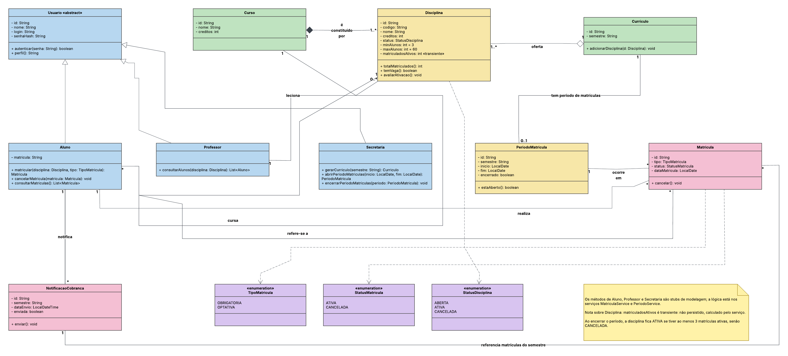

# 🎓 Sistema de Matrículas Universitário 👨‍💻

> [!NOTE]
> Sistema web para informatizar o processo de matrículas de uma universidade: a secretaria monta o currículo do semestre, os alunos se matriculam (ou cancelam) dentro do período de matrículas e os professores consultam seus alunos.

<!-- TODO: inserir logo do projeto -->

---

## 🚧 Status do Projeto


| Etapa | Status |
| :--- | :---: |
| Modelo de Análise (Casos de Uso + Histórias de Usuário) | ✅ |
| Projeto Estrutural: projeto Spring Boot com classes, atributos e stubs | ✅ |
| Projeto Estrutural: Diagrama de Classes (Lucidchart) | ✅ |
| Autenticação (login com senha, JWT) | ✅ |
| Protótipo: back-end (regras de negócio + API REST) | ✅ |
| Protótipo: front-end (React + Vite) | ⏳ |
| Persistência no MongoDB Atlas | ⏳ |
| Correção dos diagramas | ⏳ |

---

## 📚 Índice
- [Sobre o Projeto](#-sobre-o-projeto)
- [Funcionalidades Principais](#-funcionalidades-principais)
- [Tecnologias Utilizadas](#-tecnologias-utilizadas)
- [Modelo de Análise](#-modelo-de-análise)
  - [Atores](#atores)
  - [Diagrama de Casos de Uso](#diagrama-de-casos-de-uso)
  - [Regras de Negócio](#regras-de-negócio)
  - [Histórias de Usuário](#histórias-de-usuário)
- [Arquitetura e Diagrama de Classes](#-arquitetura-e-diagrama-de-classes)
- [Instalação e Execução](#-instalação-e-execução)
- [Estrutura de Pastas](#-estrutura-de-pastas)
- [Autores](#-autores)
- [Licença](#-licença)

---

## 📝 Sobre o Projeto

Uma universidade pretende informatizar seu sistema de matrículas. Hoje a secretaria precisa gerir manualmente currículos, disciplinas, professores e alunos, além de acompanhar quais disciplinas atingiram o mínimo de inscritos.

O sistema resolve isso permitindo que:

- a **secretaria** gere o currículo de cada semestre e mantenha o cadastro de cursos, disciplinas, professores e alunos;
- o **aluno** se matricule em disciplinas (4 obrigatórias + 2 optativas) e cancele matrículas durante o período de matrículas;
- o **professor** consulte os alunos matriculados em cada uma de suas disciplinas;
- o **sistema de cobranças** seja notificado após a matrícula do aluno, para cobrar as disciplinas do semestre.

Contexto: projeto acadêmico (Laboratório 03 — DIAW, Engenharia de Software, PUC Minas).

---

## ✨ Funcionalidades Principais

- 🔐 **Autenticação:** login obrigatório (usuário e senha) para alunos, professores e secretaria.
- 🗂️ **Gestão acadêmica (secretaria):** cursos, disciplinas, professores, alunos e currículo por semestre.
- 📅 **Períodos de matrícula:** abertura e encerramento controlados pela secretaria.
- 📝 **Matrícula e cancelamento (aluno):** 4 disciplinas obrigatórias + 2 optativas.
- ✅ **Ativação de disciplinas:** ao fim do período, disciplinas com menos de 3 inscritos são canceladas; limite de 60 inscritos por disciplina.
- 💳 **Integração com cobranças:** notificação ao sistema de cobranças após a matrícula.
- 👨‍🏫 **Consulta de alunos por disciplina (professor).**

---

## 🛠 Tecnologias Utilizadas

| Camada | Tecnologia |
| :--- | :--- |
| Linguagem | Java – JDK 25 |
| Back-end | Spring Boot 4.0.x |
| Build/dependências | Apache Maven |
| Front-end | React + Vite |
| Banco de dados | MongoDB Atlas (Spring Data MongoDB) |
| Autenticação | Login e senha (Spring Security, senhas com hash) |

---

## 🧭 Modelo de Análise

### Atores

| Ator | Descrição |
| :--- | :--- |
| **Aluno** | Realiza e cancela matrículas dentro do período aberto. |
| **Professor** | Consulta os alunos matriculados em suas disciplinas. |
| **Secretaria** | Gerencia cadastros, currículo e períodos de matrícula. |
| **Sistema de Cobranças** | Sistema externo notificado após a matrícula do aluno. |

### Diagrama de Casos de Uso

<!-- TODO: exportar o diagrama do Lucidchart como PNG, salvar em docs/diagramas/casos-de-uso.png -->


### Regras de Negócio

| ID | Regra |
| :---: | :--- |
| RN01 | Todo usuário (aluno, professor, secretaria) deve se autenticar com usuário e senha. |
| RN02 | Cada curso possui nome, número de créditos e é composto por diversas disciplinas. |
| RN03 | O aluno pode se matricular em **4 disciplinas obrigatórias** e **2 optativas** (alternativas). |
| RN04 | Matrículas e cancelamentos só são possíveis **durante o período de matrículas**. |
| RN05 | Ao fim do período, a disciplina com **menos de 3 alunos** matriculados é **cancelada**; com 3 ou mais, fica **ativa** no semestre seguinte. |
| RN06 | O máximo é de **60 alunos** por disciplina; ao atingi-lo, as matrículas dessa disciplina são encerradas. |
| RN07 | Após o aluno se inscrever no semestre, o **sistema de cobranças é notificado**. |
| RN08 | O professor só visualiza os alunos das disciplinas em que leciona. |

### Histórias de Usuário

#### 🔐 Autenticação

**US01 — Login**
> Como **usuário** (aluno, professor ou secretaria), quero **entrar no sistema com usuário e senha**, para **acessar as funcionalidades do meu perfil**.
- [ ] Credenciais válidas levam ao painel do perfil correspondente.
- [ ] Credenciais inválidas exibem mensagem de erro e não dão acesso.
- [ ] Rotas protegidas exigem autenticação e respeitam o perfil.

**US02 — Logout**
> Como **usuário**, quero **sair do sistema**, para **proteger minha conta**.
- [ ] Após o logout, a sessão/token é invalidado.

#### 🏛️ Secretaria

**US03 — Gerenciar cursos**
> Como **secretaria**, quero **cadastrar, editar e remover cursos** (nome e número de créditos), para **manter a estrutura acadêmica atualizada**.
- [ ] Curso exige nome e número de créditos.
- [ ] Curso pode ser associado a várias disciplinas.

**US04 — Gerenciar disciplinas**
> Como **secretaria**, quero **cadastrar, editar e remover disciplinas**, para **compor os cursos e o currículo**.
- [ ] Disciplina informa nome, código, créditos e professor responsável.
- [ ] Limites de 3 (mínimo) e 60 (máximo) inscritos são aplicados.

**US05 — Gerenciar professores**
> Como **secretaria**, quero **cadastrar, editar e remover professores**, para **alocá-los às disciplinas**.
- [ ] Ao cadastrar, é definida uma senha de acesso.

**US06 — Gerenciar alunos**
> Como **secretaria**, quero **cadastrar, editar e remover alunos**, para **que possam acessar o sistema e se matricular**.
- [ ] Ao cadastrar, é definida uma senha de acesso e o curso do aluno.

**US07 — Gerar currículo do semestre**
> Como **secretaria**, quero **gerar o currículo de cada semestre**, associando as disciplinas ofertadas, para **que os alunos saibam o que podem cursar**.
- [ ] O currículo é vinculado a um semestre (ex.: 2026/2).
- [ ] Apenas disciplinas do currículo ficam disponíveis para matrícula.

**US08 — Gerenciar período de matrículas**
> Como **secretaria**, quero **abrir e encerrar o período de matrículas**, para **controlar quando os alunos podem se matricular ou cancelar**.
- [ ] Define data de início e fim.
- [ ] Fora do período, matrículas e cancelamentos são bloqueados.

**US09 — Consolidar disciplinas ao fim do período**
> Como **secretaria**, quero que, **ao encerrar o período, o sistema ative ou cancele cada disciplina**, para **confirmar quais ocorrerão no semestre seguinte**.
- [ ] Disciplina com ≥ 3 inscritos fica **ativa**.
- [ ] Disciplina com < 3 inscritos fica **cancelada**.
- [ ] A secretaria consegue consultar o resultado por disciplina.

#### 🎒 Aluno

**US10 — Matricular-se em disciplinas**
> Como **aluno**, quero **me matricular em disciplinas do semestre**, para **cursá-las**.
- [ ] O aluno escolhe o tipo de cada matrícula: até 4 como obrigatórias (1ª opção) e 2 como optativas (alternativas).
- [ ] Bloqueia matrícula em disciplina com 60 inscritos.
- [ ] Só funciona dentro do período de matrículas.
- [ ] Não permite matrícula duplicada na mesma disciplina.

**US11 — Cancelar matrícula**
> Como **aluno**, quero **cancelar uma matrícula feita anteriormente**, para **ajustar minhas escolhas**.
- [ ] Só funciona dentro do período de matrículas.
- [ ] A vaga é liberada na disciplina.

**US12 — Consultar minhas matrículas**
> Como **aluno**, quero **ver as disciplinas em que estou matriculado e o status de cada uma**, para **acompanhar minha situação**.
- [ ] Lista disciplinas, tipo (obrigatória/optativa) e status (ativa/cancelada após o fim do período).

**US13 — Notificar cobrança**
> Como **aluno**, quero que **o sistema de cobranças seja notificado após eu concluir a matrícula do semestre**, para **ser cobrado pelas disciplinas cursadas**.
- [ ] A notificação contém aluno, semestre e disciplinas.
- [ ] Falhas na notificação são registradas para novo envio.

#### 👨‍🏫 Professor

**US14 — Consultar alunos por disciplina**
> Como **professor**, quero **ver a lista de alunos matriculados em cada uma das minhas disciplinas**, para **acompanhar a turma**.
- [ ] Lista apenas disciplinas do professor autenticado.
- [ ] Mostra nome e matrícula dos alunos.

---

## 🏗 Arquitetura e Diagrama de Classes

### Diagrama de Classes



As classes do pacote `model` do back-end seguem este diagrama (atributos e assinaturas dos métodos); as associações são persistidas com `@DBRef` no MongoDB.

Arquitetura prevista: **API REST em camadas** (controller → service → repository) com Spring Boot, front-end SPA em React + Vite e persistência em MongoDB Atlas.

---

## 🔧 Instalação e Execução

<!-- TODO: preencher quando o projeto estiver implementado (variáveis de ambiente, back-end, front-end) -->
_Em construção._

---

## 📂 Estrutura de Pastas

```
.
├── README.md
├── /docs
│   └── /diagramas      # Diagramas UML (casos de uso, classes) — todas as versões
├── /backend            # Spring Boot (a criar)
└── /frontend           # React + Vite (a criar)
```

---

## 👥 Autores

| 👤 Nome | :octocat: GitHub |
|---------|-----------------|
| Diego | _link_ |

---

## 📄 Licença

Projeto acadêmico. Licença MIT.
